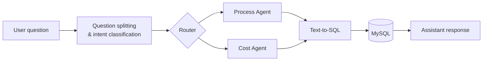
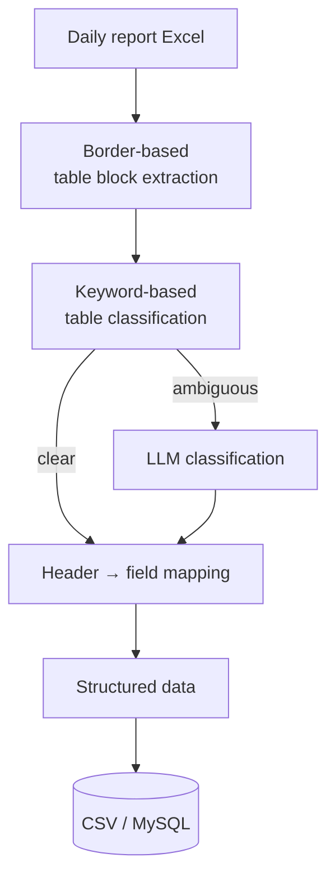
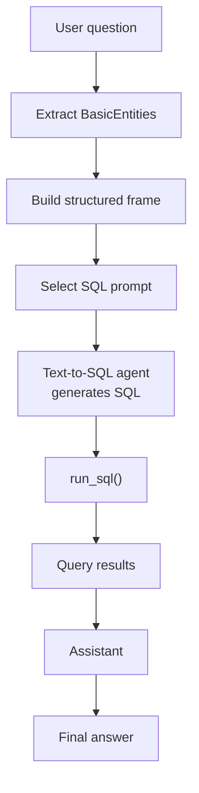

# Construction Site Assistant

## Overview

The assistant classifies each user question into domains such as **process (schedule)**, **cost**, and **quality**, and routes it to a domain-specific agent.

I was responsible for the **Process** and **Cost** domains. Unlike document-based RAG, these agents answer questions by querying **daily construction report data stored in MySQL** through Text-to-SQL.

  

## My role

| Area              | Responsibilities                                                                                                                                                                                    |
| ----------------- | --------------------------------------------------------------------------------------------------------------------------------------------------------------------------------------------------- |
| **Data modeling** | Designed the relational database schema                                                                                                                                                             |
| **Data pipeline** | Parsed and preprocessed daily report Excel files · extracted table regions from unstructured sheets · classified table types · mapped Excel headers to DB fields · loaded processed data into MySQL |
| **Agents**        | Designed the Text-to-SQL flow for process and cost queries · implemented process and cost agents with LangGraph and LangChain                                                                       |
| **Query design**  | Separated SQL generation from execution · designed the structure for detail vs. aggregate queries                                                                                                   |

  

## Preprocessing pipeline

Each daily report sheet contained multiple tables — work items, task descriptions, labor, equipment, materials, and per-subcontractor labor and equipment — and **their positions varied from file to file**.

Instead of sending the entire sheet to an LLM, I **extracted individual table blocks based on cell borders** and used the LLM only where rule-based logic was not enough. This kept the pipeline faster, cheaper, and more predictable.

  

## Agent & Text-to-SQL design

The agent first extracts structured information from the question — **site, work type, subcontractor, and period** — and then generates SQL from that structured frame rather than from raw text.

**SQL generation and execution are separated**, so the generated query can be inspected and controlled before it touches the database.

When a single question contains both process and cost intents, **the two agents run in parallel** and their results are merged into one answer.

  

## Retrospectives

Problems I ran into during implementation and how the design evolved are documented separately:

- [Preprocessing Pipeline Retrospective](./PREPROCESSING_RETROSPECTIVE.md)
- [Text-to-SQL Agent Retrospective](./AGENT_RETROSPECTIVE.md)

  

## Tech stack

| Category        | Tools                               |
| --------------- | ----------------------------------- |
| **LLM / Agent** | LangGraph · LangChain · Text-to-SQL |
| **Data**        | Python · Pandas · openpyxl · MySQL  |
| **Backend**     | Python · SQL · RDB                  |

